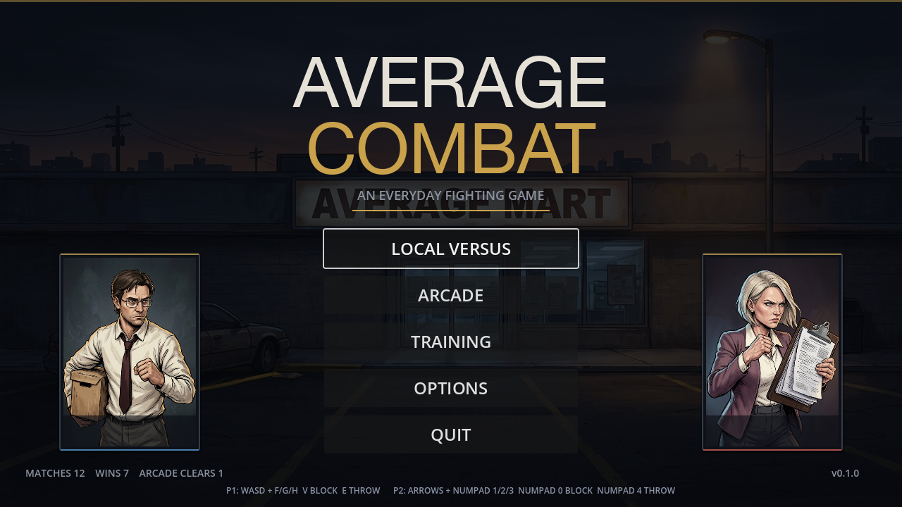
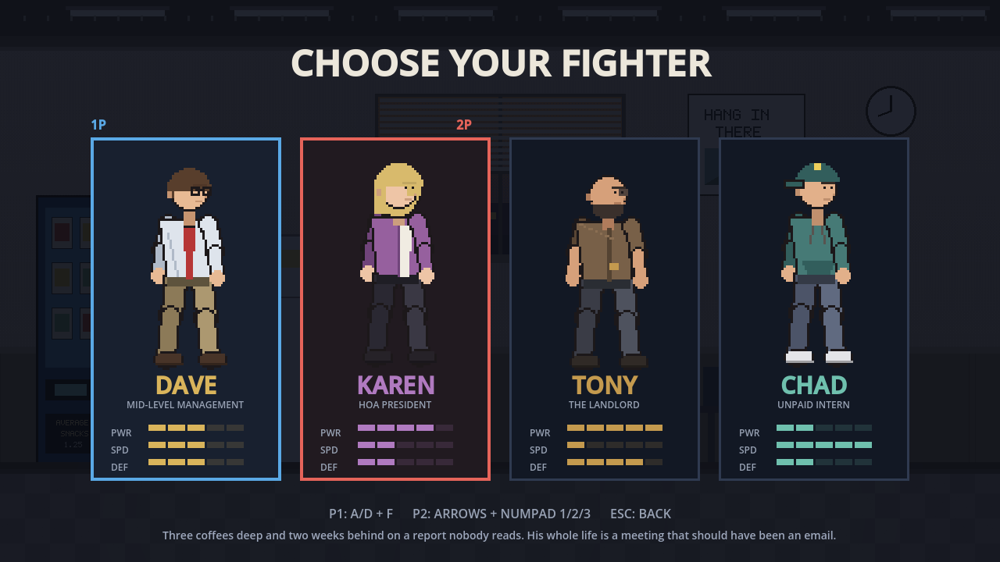
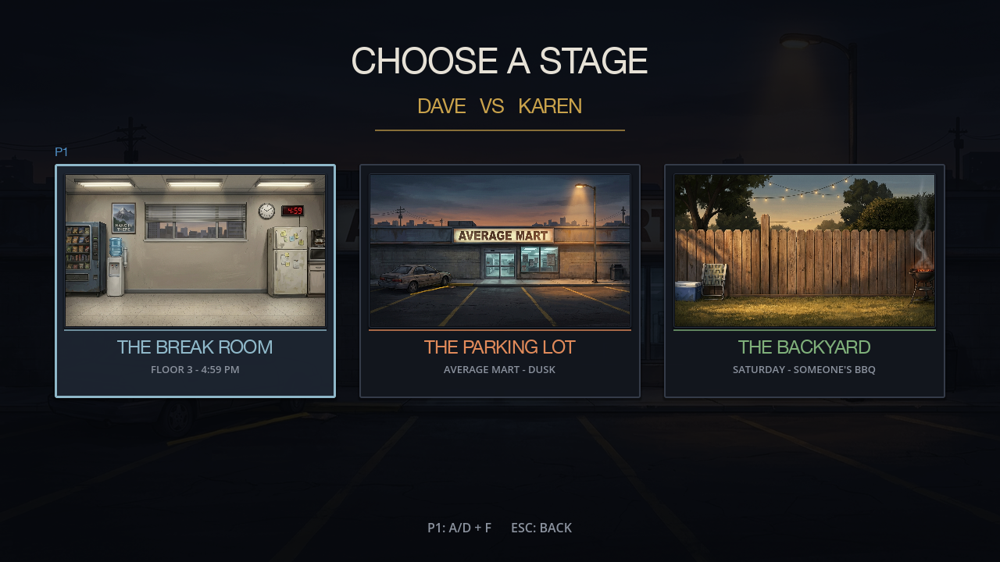
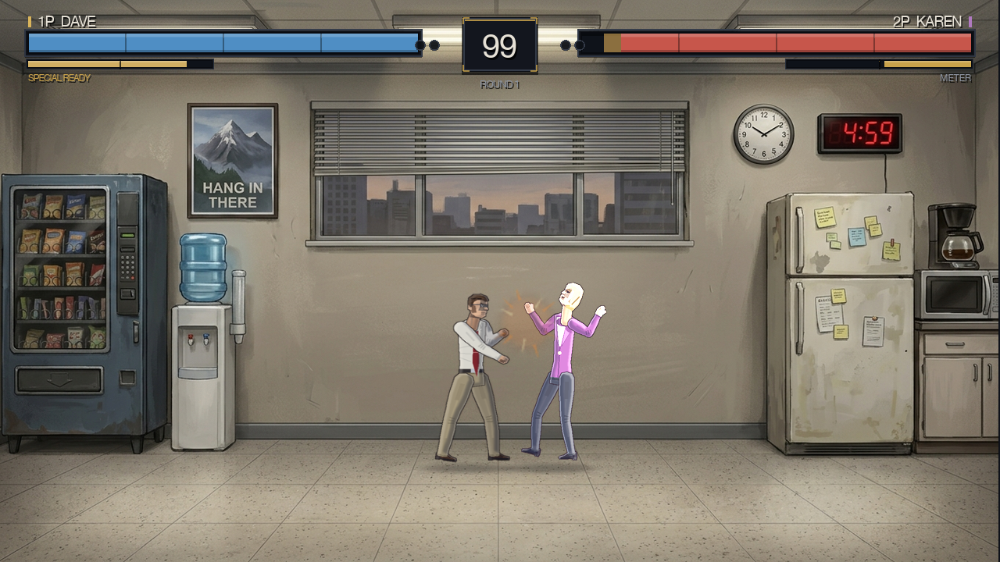
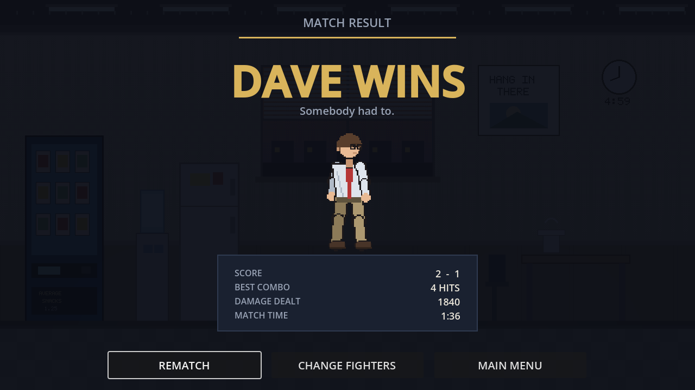

# Average Combat

An everyday fighting game. Four ordinary people with ordinary problems settle
them the way nature intended: one-on-one, best of three, in the break room.

Built with **Godot 4.7** (compatibility renderer), 1280x720, 2D pixel art.



## Play it

On a fresh checkout, import the assets and build the script class cache before
launching.

```sh
godot --headless --path . --import && godot --path .
```

For later launches, run `godot --path .`. You can also open the project in the
Godot editor and press F5.

The game starts on the title screen. Everything is playable with the keyboard;
gamepads work too.

## Controls

| Action | Player 1 | Player 2 |
| --- | --- | --- |
| Move / crouch | `A` `D` / `S` | `←` `→` / `↓` |
| Jump | `W` | `↑` |
| Light attack | `F` | `Numpad 1` (or `,`) |
| Heavy attack | `G` | `Numpad 2` (or `.`) |
| Special (50 meter) | `H` | `Numpad 3` (or `/`) |
| Block | `V` (or hold away) | `Numpad 0` (or `'`) |
| Pause | `Esc` | `Esc` |

Gamepads: pad 1 drives P1, pad 2 drives P2. D-pad or left stick to move,
`A/B/X/Y` for light/heavy/special/block, `Start` to pause during a match.
Use the D-pad to navigate menus and `A` to confirm. `B` backs out of character
select and stage select and closes the pause menu.

**Blocking rules** are Mortal Kombat-ish: hold back or the block key. Standing
block stops high and mid attacks, crouch block stops low and mid. Sweeps knock
down. Attacking builds meter; a full special costs 50 of 100.

## Modes

- **Local Versus** - two players on one keyboard, or two pads. First to two rounds.
- **Arcade** - fight the other three characters in a shuffled ladder, one round
  per opponent, and get a results screen between fights.
- **Training** - a passive dummy, infinite time, automatic reset after a KO.
  Press `F5` to reset both fighters during training.

## Roster

| Fighter | Day job | Style |
| --- | --- | --- |
| **Dave** | Mid-level management | Balanced; lunging box special |
| **Karen** | HOA president | Zoner; throws a clipboard projectile |
| **Tony** | The landlord | Grappler; slow, armored, heavy damage |
| **Chad** | Unpaid intern | Rushdown; fast dash special |

Stages: **The Break Room**, **The Parking Lot**, **The Backyard**.

## Project layout

```
assets/            generated sprites, stage art, SFX (safe to replace)
scenes/            thin .tscn wrappers; UI is built from code
scripts/autoload/  SaveData, Controls, Sfx, UITheme, Game (scene flow)
scripts/data/      CharacterDB and StageDB - all tuning lives here
scripts/fight/     fixed-tick simulation: fighter, arena, HUD, AI, input
scripts/ui/        menu screens + UI kit
tests/             headless suites (smoke, flow, mode rules) and a screenshot harness
tools/             Python generators for art and audio
docs/              design notes and roadmap
```

The fight scene is self-contained: `Game.match_config` is read on boot, and the
result is handed back through `Game.on_match_end()`. Input is read only in
`arena.gd` and turned into plain dictionaries, so an AI or a future network peer
drives a fighter through the same code path.

## Tuning

All frame data, hitboxes, damage, and movement stats live in
`scripts/data/character_db.gd`. Move timings are in 60 Hz ticks; hitboxes are
feet-relative rectangles (negative Y is up). Stage bounds and spawn positions are
in `scripts/data/stage_db.gd`.

The simulation runs at a fixed 60 Hz with an accumulator, independent of render
framerate. That is deliberate groundwork for rollback netcode later.

## Assets

All current art and audio are generated placeholders, made by the scripts in
`tools/`. Regenerate them with a local virtualenv:

```sh
python3 -m venv .venv
.venv/bin/pip install pillow
.venv/bin/python tools/gen_art.py
.venv/bin/python tools/gen_audio.py
```

Art is indexed-color pixel work; `tools/pixel_art.py` holds the shared drawing
helpers. To swap in real art, keep the sheet layout (6 columns x 12 rows of
64x96 cells) or update `CharacterDB.ANIMS` to match.

## Tests

The test runner imports the project and runs the headless scenes in `tests/`.
It exits nonzero on a failed test or engine error.

```sh
./tests/run.sh
```

After importing, you can also run individual suites.

```sh
godot --headless --path . res://tests/smoke.tscn
godot --headless --path . res://tests/flow.tscn
```

The suites cover combat, scene navigation, mode rules, and save persistence.
Test scenes use a separate temporary save file from startup. The smoke test
writes and reloads that file to verify persistence.

Screenshots (needs a display, not `--headless`, and not part of `./tests/run.sh`):

```sh
godot --resolution 1280x720 res://tests/screens.tscn
```

Writes to `screenshots/`. Running it directly is also isolated from the normal save.

## Screens

| | |
| --- | --- |
|  |  |
|  |  |

## Status

This is a complete local skeleton, not a finished game. See
[docs/ROADMAP.md](docs/ROADMAP.md) for what comes next. Online play is not
implemented yet, but the simulation/input split is designed to accept it.
